# 🐐 gtcd — Modern Web Dashboard for GoatCounter

[](https://kit.svelte.dev/)
[](https://svelte.dev/)
[](https://www.typescriptlang.org/)
[](https://tailwindcss.com/)
[](https://shadcn-svelte.com/)
[](https://reui.io/)
[](https://www.docker.com/)
[](LICENSE)

A fast, responsive, and customizable self-hosted web dashboard for [GoatCounter](https://www.goatcounter.com/) analytics. Built with **Svelte 5 Runes**, **Tailwind CSS v4**, and a **shadcn-svelte** component layer ported from the **[ReUI](https://reui.io/)** design system (`base-nova` style).

---

## 💡 What is gtcd?

[GoatCounter](https://github.com/arp242/goatcounter) is an incredible privacy-friendly web analytics platform: it is lightweight, tracks page views without invasive cookies or GDPR consent popups, and is very easy to self-host.

**`gtcd` is a custom frontend dashboard for your GoatCounter instance.** It connects to your GoatCounter server via its REST API and provides an alternative, modern web UI with:

- **Svelte 5 Runes**: Fast, reactive client-side navigation with zero bundle bloat.
- **Curated Dark & Light Modes**: Clean UI built on ReUI/shadcn CSS design tokens (`.dark` class on the document root, applied before first paint to avoid flashing).
- **Power-User Ergonomics**: Collapsible desktop sidebar with `Cmd+B` / `Ctrl+B` toggle, mobile drawer, GoatCounter's period presets (day, week, month, quarter, half year, year) with back/forward stepping, saved report views, and a customizable overview.
- **Your GoatCounter Preferences**: Dates, hours, and numbers follow the timezone, date format, 24-hour clock, and thousands separator set in GoatCounter, so report ranges match GoatCounter's own dashboard even when the server runs in UTC.
- **Safe Server-Side API Mediation**: The browser never sees your `GOATCOUNTER_API_KEY`. Authentication uses HTTP-only session cookies validated against your GoatCounter login. Docker Compose passes `PROTOCOL_HEADER`/`HOST_HEADER`, so CSRF origin checks and cookie flags derive from the reverse proxy's request headers.
- **Zero Third-Party Requests**: Fonts are self-hosted; the dashboard makes no calls to external CDNs, so visitor IPs never leak to third parties and it works fully offline.
- **Upstream Rate-Limit Protection**: An outbound queue pacer (280ms spacing), exponential backoff with jitter, and a 30s query cache prevent `429 Too Many Requests` errors from GoatCounter's 4 req/sec limit.
- **Resilient Session Store**: Distributed Redis session layer with automatic fallback to an in-memory store if Redis is unavailable.
- **Accessible Visualizations (WCAG 2.1 AA)**: Interactive charts with SVG `<title>`, `<desc>`, semantic `role="meter"`, high-contrast focus rings, and screen-reader accessible data tables.
- **Installable PWA**: Web app manifest, service worker with auto-update, and offline-cached app assets — installable from the browser address bar.
- **Server-Side Query Cache**: Report data loads through SvelteKit server loads; identical upstream requests share one in-flight call and a 30-second cache, so quick range switches don't re-hit GoatCounter.

---

## 🏗️ Architecture

`gtcd` acts as a secure presentation and caching layer in front of your GoatCounter instance:

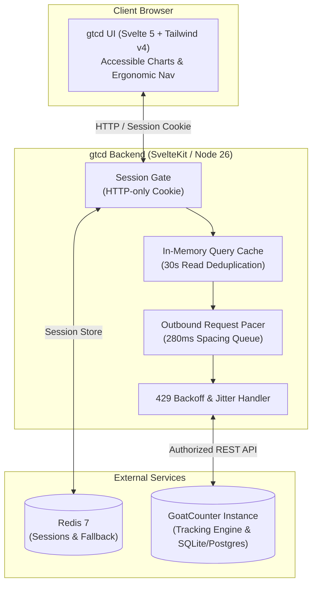

---

## 📊 Features & Views

- **Overview Dashboard**: Instant KPIs (total visitors, total pageviews) and an interactive SVG traffic time-series chart with date-range filters.
- **Top Content & Pages**: List of tracked paths with visitor counts, percentage bars, search filtering, and per-path drill-downs.
- **Referrer Attribution**: Per-page breakdown of referring domains and external links.
- **Client Telemetry**:
  - **Browsers**: Browser breakdown with version drill-downs.
  - **Operating Systems**: OS distribution with version drill-downs.
  - **Devices & Sizes**: Screen resolutions and device classification.
- **Audience Geography & Localization**:
  - **Locations**: Visitor distribution by country and region.
  - **Languages**: Browser locale and language breakdown.
- **Campaign Tracking**: Monitor marketing campaigns via URL query parameters.
- **Site Administration**: Designated dashboard administrators can update site
  retention, ignored IP/CIDR ranges, regional reporting countries, embedding
  origins, and public-counter settings without exposing the API token.
- **Data Exports**: Administrators can create and download gzip-compressed CSV
  exports through the GoatCounter API.
- **Saved Views & Overview Layout**: Save a period, filter, grouping, and chart scale under a name, pick a default view, and choose which overview widgets show and in what order. Stored per user in Redis (in-memory fallback); hidden widgets skip their GoatCounter requests.
- **Sharing & Visitor Counter**: Set dashboard visibility (private, secret link, public), generate the access token and share link, and copy ready-made visitor-counter embeds (`/counter/<path>.svg|png|html|json`).
- **Readable Charts**: Toggle the traffic chart to a data table, and switch page sparklines between per-page and shared scale. Event counts appear next to pageview totals.
- **Data Normalization**: Empty or null metric names are automatically normalized to `"Unknown"` for clean chart display.

---

## 🖼️ Screenshots

Captured from a local build against a synthetic GoatCounter upstream whose user
prefers the Asia/Jakarta timezone, ISO dates, and comma separators; the numbers
are illustrative.

### Traffic overview

<table>
  <tr>
    <td>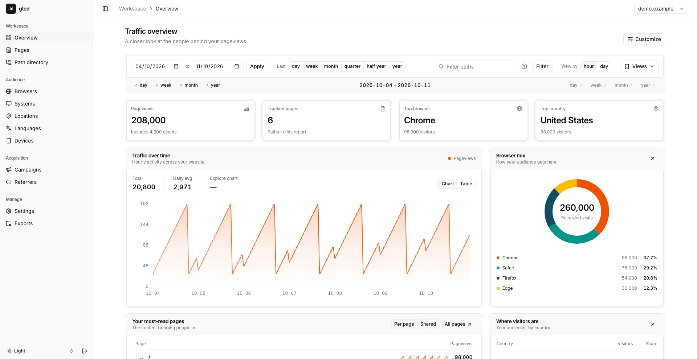</td>
    <td>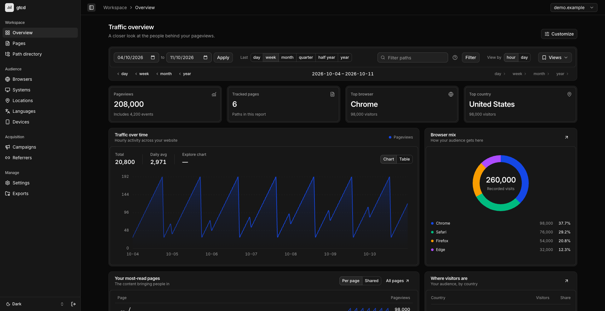</td>
  </tr>
</table>

<p align="center">
  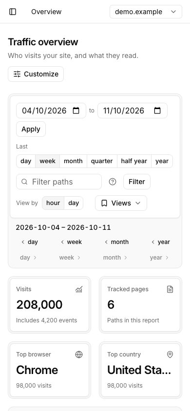
</p>

### Pages and paths

<table>
  <tr>
    <td>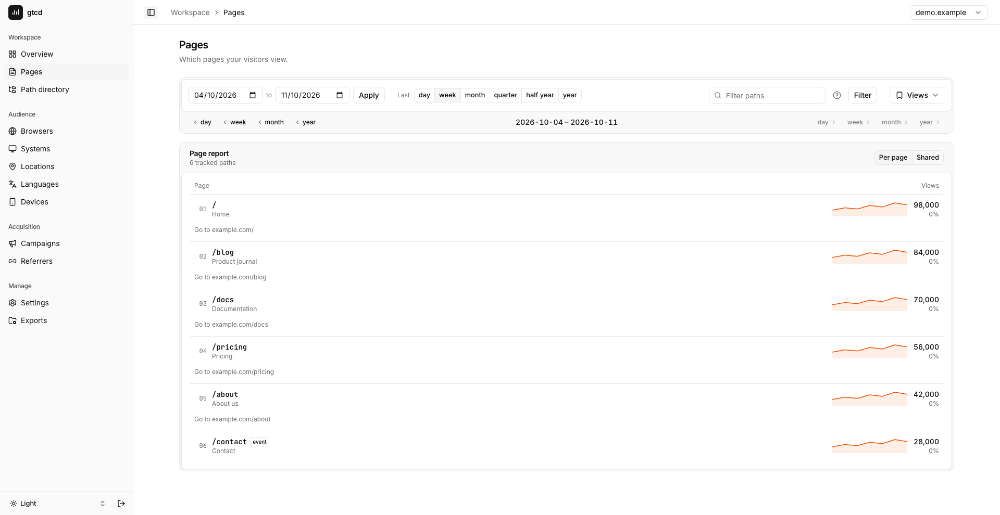</td>
    <td>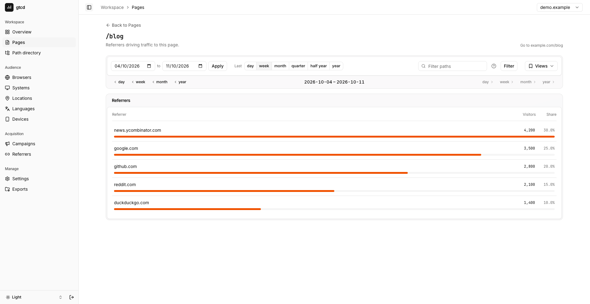</td>
  </tr>
  <tr>
    <td>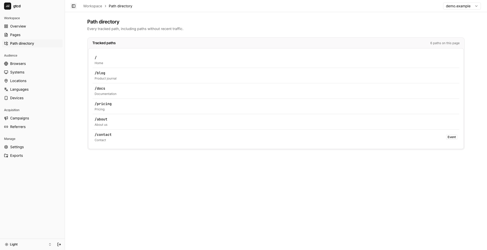</td>
    <td>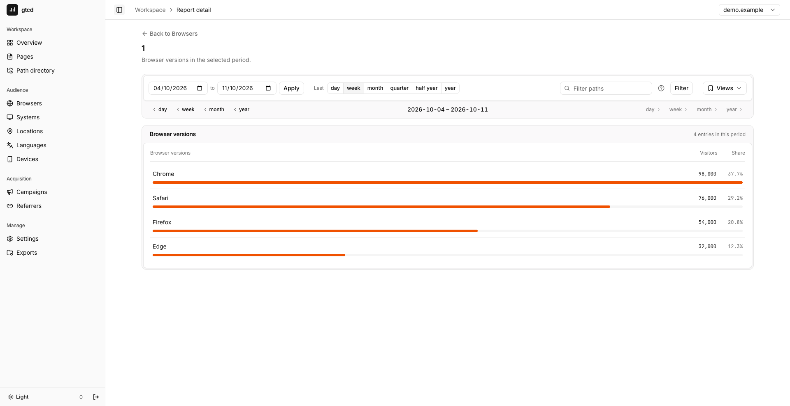</td>
  </tr>
</table>

### Audience and acquisition

<table>
  <tr>
    <td>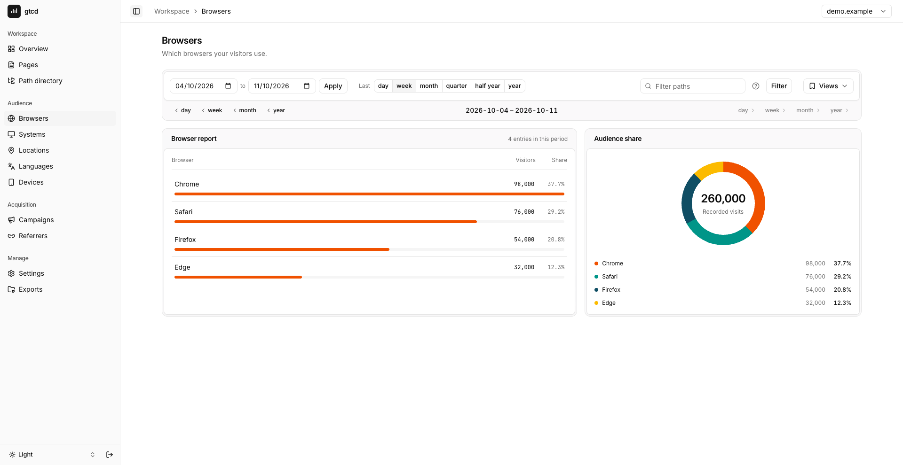</td>
    <td>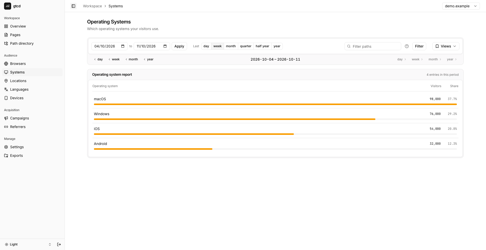</td>
  </tr>
  <tr>
    <td>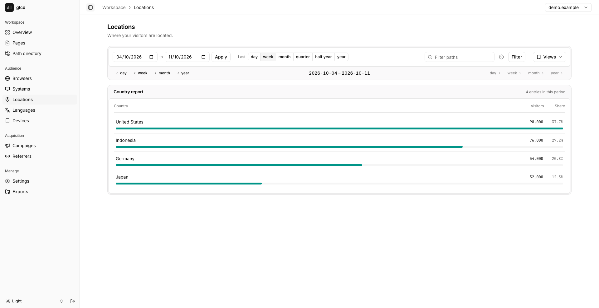</td>
    <td>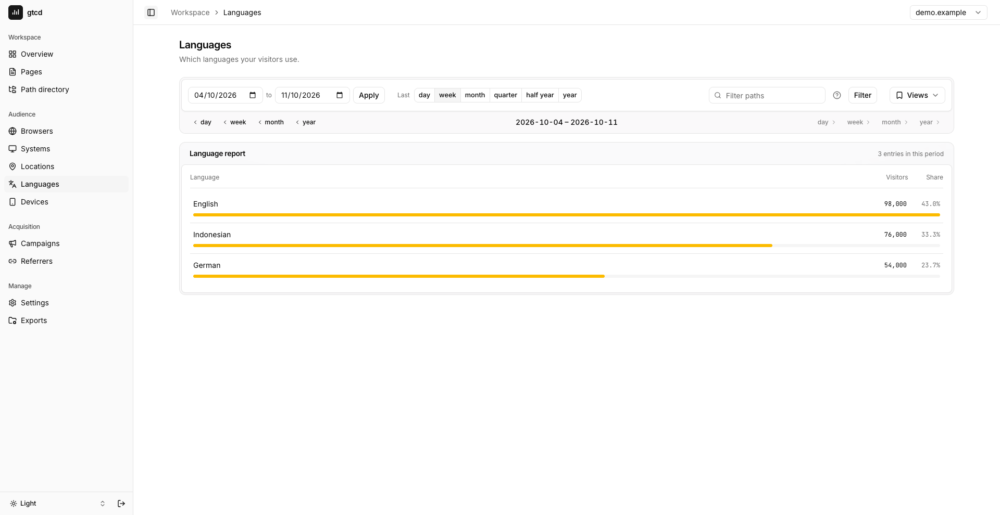</td>
  </tr>
  <tr>
    <td>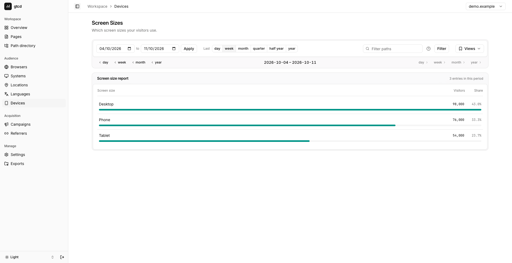</td>
    <td>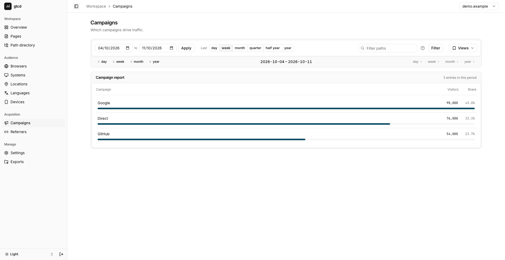</td>
  </tr>
  <tr>
    <td>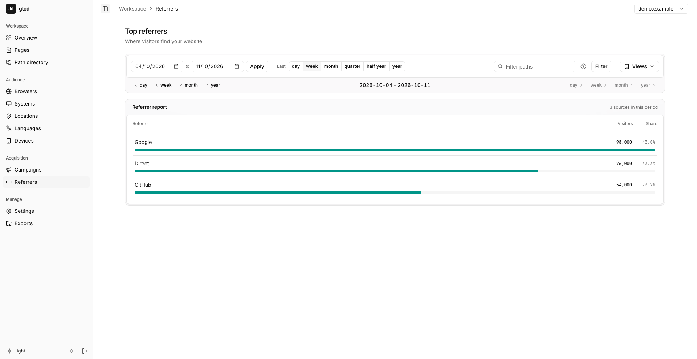</td>
    <td>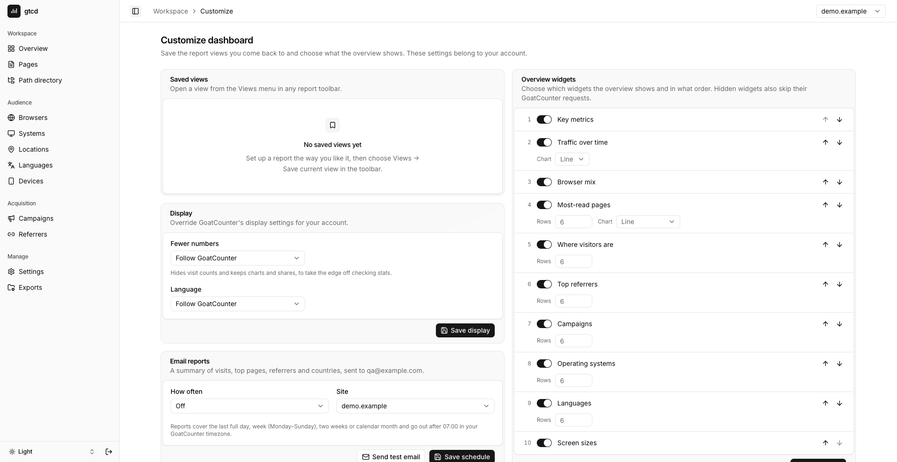</td>
  </tr>
</table>

### Administration

<table>
  <tr>
    <td>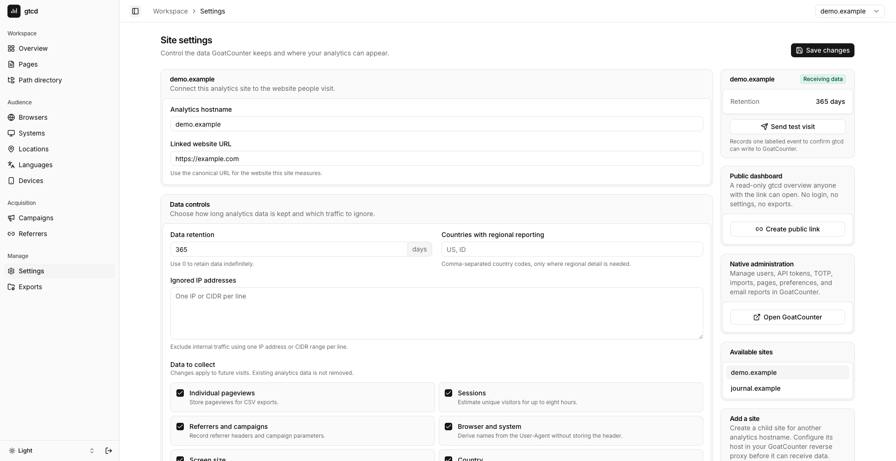</td>
    <td>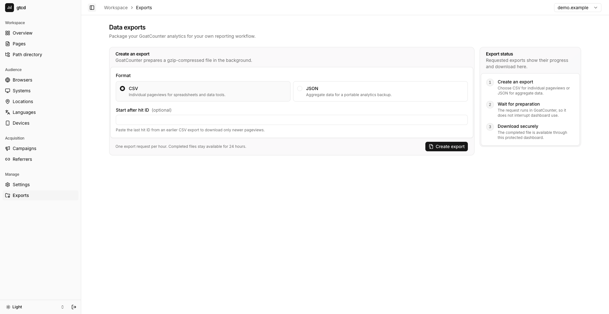</td>
  </tr>
</table>

### Sign in and errors

<table>
  <tr>
    <td>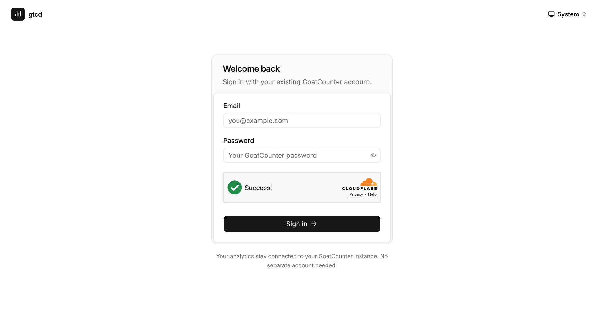</td>
    <td>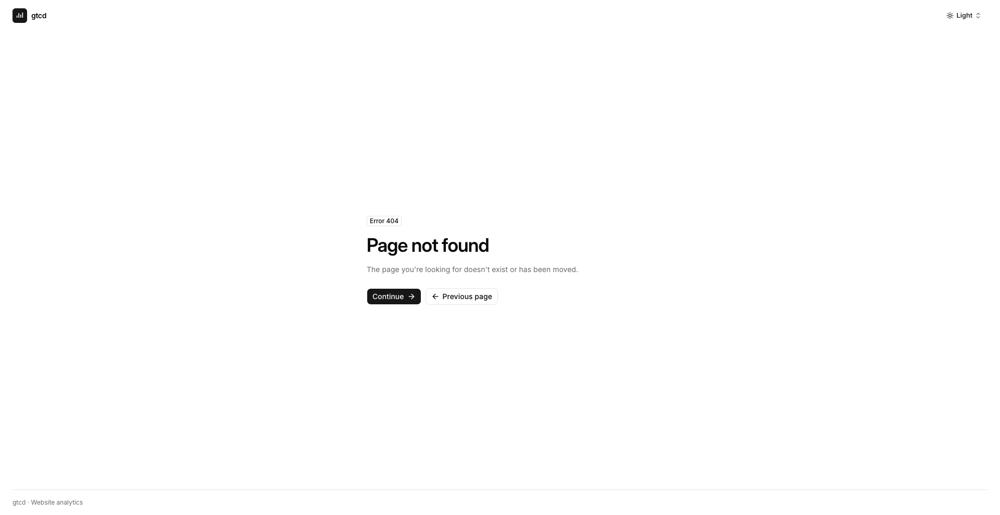</td>
  </tr>
</table>

---

## 🚀 Quickstart

### 1. Run with Docker Compose (Easiest)

The fastest way to spin up the whole stack (Caddy + GoatCounter + Redis + `gtcd`):

```bash
# Clone the repository
git clone https://github.com/haikelz/gtcd.git
cd gtcd

# Run the automated setup script
./scripts/setup.sh
```

The setup script will:

1. Ask for your domain (`localhost` for dev, `analytics.example.com` for production)
2. Prompt for your GoatCounter admin email and password
3. Create the GoatCounter site and admin user
4. Generate an API token with all permissions
5. Generate a Caddyfile for reverse proxying
6. Save all credentials to `.env`
7. Start the full stack

**Or manually:**

```bash
cp .env.example .env
# Redis loads its password from secrets/redis.conf (gitignored)
mkdir -p secrets && chmod 700 secrets
printf 'requirepass %s\n' "$(openssl rand -hex 32)" > secrets/redis.conf
chmod 644 secrets/redis.conf
# Edit .env: credentials, domain, and REDIS_URL with the same password
nano .env
docker compose up -d --build
```

Services will be accessible at:

- **gtcd Dashboard**: `https://localhost` (Caddy redirects HTTP and uses a locally-issued certificate — trust it once in your browser; or `https://analytics.example.com` for production)
- **Tracking Endpoint**: `https://localhost/count` (or `https://analytics.example.com/count`)
- **GoatCounter**: internal only — reachable from the other containers at `http://goatcounter:8080`, not exposed on the host
- **Health Check**: `http://localhost/api/health`

#### Custom Domain Setup

For production, point your DNS A record to your server and run:

```bash
./scripts/setup.sh
# Enter: analytics.example.com
# Caddy will auto-provision TLS certificates via Let's Encrypt
```

Add the tracking snippet to your website:

```html
<script
  data-goatcounter="https://analytics.example.com/count"
  async
  src="//gc.zgo.at/count.js"
></script>
```

---

### 2. Local Bare-Metal Development

Requirements: Node.js 22+ and [pnpm](https://pnpm.io/) 9+ (the Docker image runs `node:26-alpine`).

```bash
# Install dependencies
pnpm install

# Set up local .env
cp .env.example .env

# Run development server with hot-reload
pnpm dev

# Run TypeScript & Svelte type checking
pnpm check

# Production build
pnpm build
```

---

### 3. CI/CD: Docker Hub image

[`.github/workflows/docker.yml`](.github/workflows/docker.yml) runs on every push
and pull request to `master` and on `v*.*.*` tags:

1. **Verify**: `pnpm lint`, `pnpm check`, the preferences self-check, and
   `pnpm build`.
2. **Smoke test**: builds the amd64 image and runs
   [`scripts/smoke-image.sh`](scripts/smoke-image.sh), which starts it with a
   read-only root filesystem and no capabilities, waits for `/login`, checks
   `/api/health`, and confirms a clean exit on `SIGTERM`.
3. **Publish** (not on pull requests): pushes a `linux/amd64` + `linux/arm64`
   image with SBOM and provenance, then smoke-tests the published arm64 image.

Add these repository secrets under **Settings → Secrets and variables →
Actions**:

| Secret            | Value                                               |
| :---------------- | :-------------------------------------------------- |
| `DOCKER_USERNAME` | Docker Hub user or organization                     |
| `DOCKER_PASSWORD` | Docker Hub access token with **Read & Write** scope |

Images are published as `<DOCKER_USERNAME>/gtcd` (override with a
`DOCKER_IMAGE` repository variable), tagged `sha-<commit>` on every publish,
`latest` on `master`, and `<major>.<minor>.<patch>` plus `<major>.<minor>` on
version tags. Deploy the immutable `sha-` tag or the digest from the run
summary.

The Dockerfile's build stage runs on the builder's native platform and only the
runtime stage targets amd64/arm64, so cross-building on Apple Silicon also
avoids emulating Node during the build.

### 4. Self-Hosting with Kubernetes

Production manifests live in [`k8s/`](k8s/) as envsubst-templated YAML applied by a single script (no Kustomize):

```bash
# 1. Create the deploy configuration from the example
cp k8s/gtcd/.env.example k8s/.env
# Edit k8s/.env with DOMAIN, EMAIL, IMAGE, GOATCOUNTER_URL, GOATCOUNTER_API_KEY,
# and optional GTCD_ADMIN_EMAILS / GOATCOUNTER_ADMIN_URL values.

# 2. Deploy (requires kubectl and envsubst)
k8s/deploy-k8s.sh
```

The script renders the manifests with envsubst, creates the `gtcd-env` Secret
from your env values, applies GoatCounter + gtcd + Redis in dependency order,
and rolls the deployment so pods pick up the current Secret.

The Kubernetes setup features:

- GoatCounter + gtcd + Redis deployed together
- Ingress routes `/count` to GoatCounter and `/` to gtcd
- Non-root hardened containers (numeric UID 1000, dropped capabilities, read-only root filesystem, `RuntimeDefault` seccomp)
- Health and readiness probes wired to `/api/health`
- Traefik Ingress with automatic Let's Encrypt TLS; application security headers
- PersistentVolumeClaim for GoatCounter data
- Session credentials delivered through a kubectl-created Secret (`gtcd-env`)
- Password-protected Redis: `deploy-k8s.sh` renders `requirepass` from
  `REDIS_PASSWORD` into a `redis-config` Secret mounted as
  `/run/secrets/redis.conf`, and gtcd builds its `REDIS_URL` from the same value

If cert-manager is absent, the ClusterIssuer step is skipped with a warning. The
Ingress does not reference optional Traefik Middleware, so an unavailable
Middleware CRD cannot make Traefik return 404 for every GTCD route.

After the first deploy, bootstrap GoatCounter (site + API token) and put the
token in `k8s/.env` as `GOATCOUNTER_API_KEY`, then re-run `k8s/deploy-k8s.sh` —
the exact commands are documented in [`k8s/gtcd/.env.example`](k8s/gtcd/.env.example).

Add the tracking snippet to your website:

```html
<script
  data-goatcounter="https://<DOMAIN>/count"
  async
  src="//gc.zgo.at/count.js"
></script>
```

---

## ⚙️ Environment Variables

Configure these in your `.env` file or container environment:

| Variable                | Required | Default                   | Purpose                                                                                                                                                                                                        |
| :---------------------- | :------: | :------------------------ | :------------------------------------------------------------------------------------------------------------------------------------------------------------------------------------------------------------- |
| `DOMAIN`                |    No    | `localhost`               | Custom domain for your dashboard (e.g., `analytics.example.com`)                                                                                                                                               |
| `GOATCOUNTER_URL`       | **Yes**  | `http://goatcounter:8080` | URL of your GoatCounter instance                                                                                                                                                                               |
| `GOATCOUNTER_API_KEY`   | **Yes**  | —                         | GoatCounter API token. Use the setup script's full-permission token (`127`), or at minimum grant the permissions required by the views you enable; site settings require site-read and site-update.            |
| `REDIS_URL`             | **Yes**  | —                         | Redis connection for sessions and saved views, with the password from `secrets/redis.conf`: `redis://:<password>@redis:6379`. `scripts/setup.sh` writes both. In Kubernetes it is built from `REDIS_PASSWORD`. |
| `PORT`                  |    No    | `3000`                    | Port for the Node.js server to listen on                                                                                                                                                                       |
| `NODE_ENV`              |    No    | `production`              | Environment mode                                                                                                                                                                                               |
| `COOKIE_SECURE`         |    No    | auto                      | Force the session cookie's `Secure` flag (`true`/`false`). By default it is set automatically from the request protocol, including `X-Forwarded-Proto` behind reverse proxies.                                 |
| `GTCD_ADMIN_EMAILS`     |    No    | —                         | Comma-separated emails permitted to manage sites and exports in gtcd.                                                                                                                                          |
| `GOATCOUNTER_ADMIN_URL` |    No    | —                         | Public HTTPS GoatCounter administration URL for users, API tokens, TOTP, imports, page management, dashboard preferences, and email reports. HTTP is allowed only on localhost.                                |

The login session cookie is `HttpOnly`, `SameSite=Lax`, and its `Secure` flag
follows the protocol the client actually used, so both `http://localhost`
development stacks and TLS production domains work without configuration.

---

## 🔒 How Authentication Works

`gtcd` separates user authentication from API access:

1. **User Login**: Users sign in on `/login` with their GoatCounter account email and password. `gtcd` verifies the credentials against GoatCounter's `/user/requestlogin` endpoint.
2. **Session Creation**: On success, `gtcd` issues an HTTP-only, `SameSite=Lax` session cookie (protocol-aware `Secure` flag) and stores the session in Redis (or in-memory fallback).
3. **API Access**: All dashboard requests are made server-side using the `GOATCOUNTER_API_KEY` defined in the environment. Your API key is never leaked to the browser.

### Site settings and administration

Site settings and exports are restricted to the email addresses in
`GTCD_ADMIN_EMAILS`. The Settings page updates the authenticated user's current
GoatCounter site only; it cannot be used to select or modify another site.

Use the Settings page for:

- the linked website URL and retention period;
- ignored IP addresses or CIDR ranges, one per line;
- comma-separated country codes for regional reporting;
- trusted embed origins, one per line; and
- the public visitor counter and Bosmang options.

The form accepts line-separated lists for readability. Before the server sends
the update to GoatCounter, it serializes `ignore_ips`, `collect_regions`, and
`allow_embed` as the comma-delimited strings required by GoatCounter's
`Strings` settings type. This avoids the `cannot unmarshal array into ...
goatcounter.Strings` API error.

Set `GOATCOUNTER_ADMIN_URL` to a public HTTPS GoatCounter administration URL to
show the **Open GoatCounter** handoff on this page. It opens in a separate tab;
the dashboard never forwards the API token to the browser. The same URL is the
base of the share link for sites set to **Secret link**.

The visitor counter is served by GoatCounter at `/counter/*`. The generated
Caddyfile and the Kubernetes Ingress route that path to GoatCounter; existing
Docker installs need `./scripts/setup.sh` re-run (or the `handle /counter/*`
block added to their Caddyfile) before the counter embeds work.

---

## ♿ Accessibility (WCAG 2.1 AA)

- **Keyboard Navigation**: Full keyboard tab order, skip link (`<a href="#main-content">`), and `Cmd+B` / `Ctrl+B` sidebar toggle.
- **Charts & Screen Readers**: Area and bar charts include accessible SVG `<title>`, `<desc>`, and hidden fallback tables (`.sr-only`) for screen-reader users.
- **Controls**: The theme menu uses menu radio items, and period presets, grouping, and chart scale use toggle groups, all with keyboard arrow navigation.
- **Reduced Motion**: All animations and transitions respect `prefers-reduced-motion: reduce`.

---

## 🤝 Contributing

Contributions, bug reports, and suggestions are welcome!

1. Fork the repo and create your branch: `git checkout -b feature/cool-idea`.
2. Ensure types and checks pass: `pnpm check && pnpm build`.
3. Commit your changes and open a Pull Request.

---

## 🙏 Acknowledgements

- [Martin Tournoij (arp242)](https://github.com/arp242) for creating [GoatCounter](https://github.com/arp242/goatcounter) — a true gem in the open-source privacy analytics space.
- The [SvelteKit](https://kit.svelte.dev/) and [shadcn-svelte](https://shadcn-svelte.com/) teams for fantastic tooling, and the [ReUI](https://reui.io/) team for the design system this dashboard is styled with.

---

## 📄 License

[MIT](LICENSE) © 2026 Haikel
